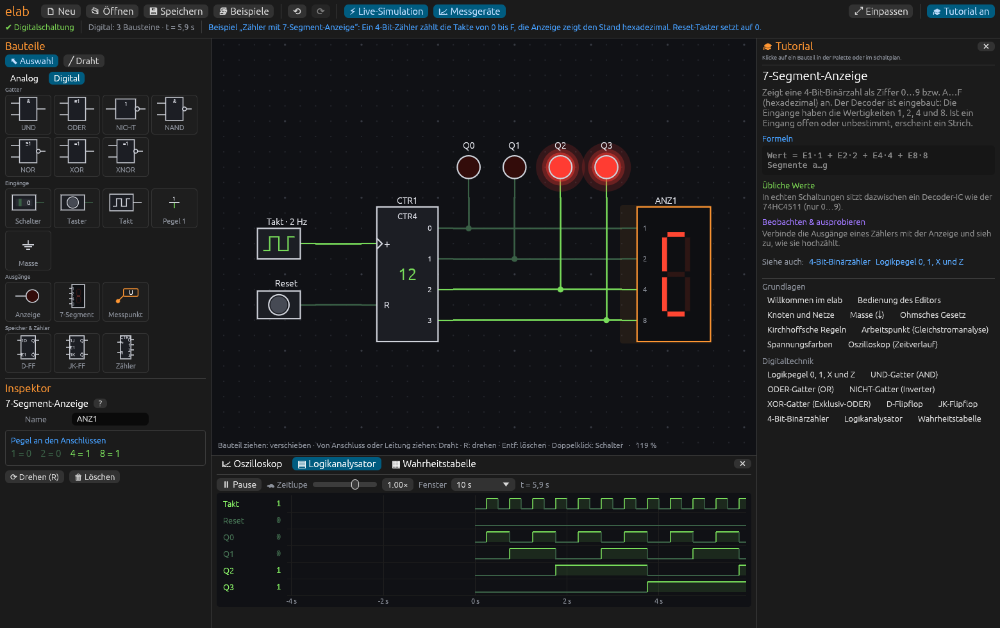
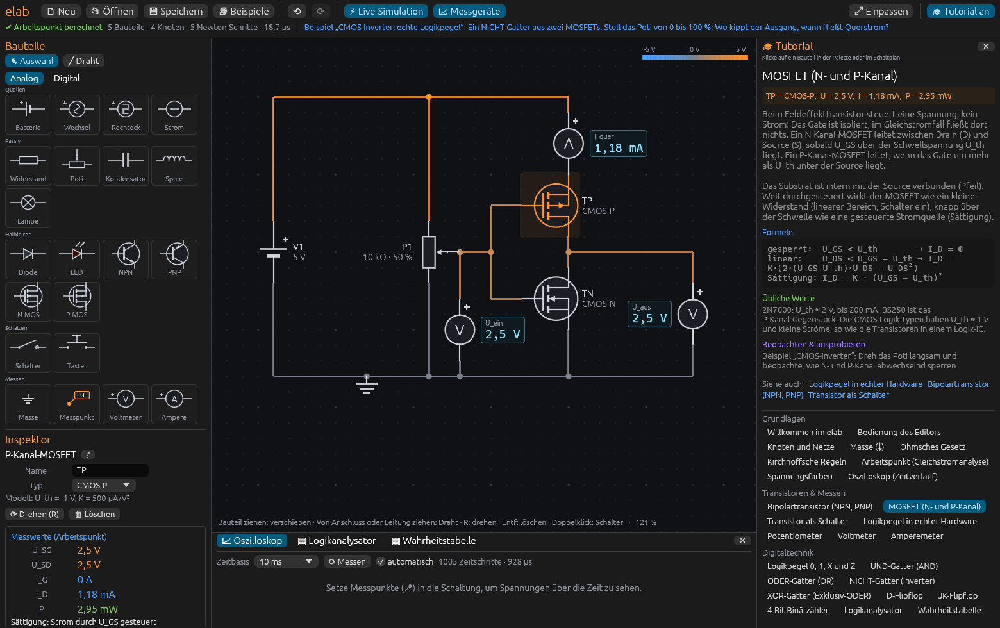
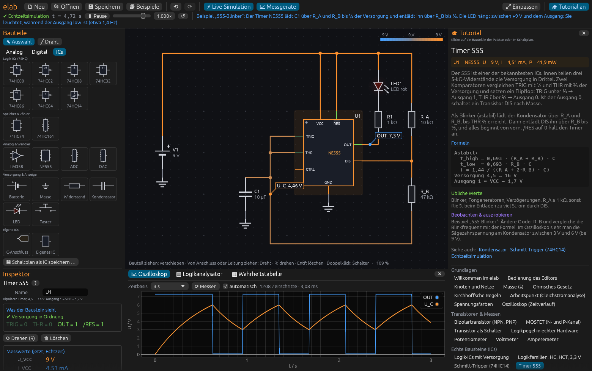

# elab – Elektronik-Lernlabor

Schaltungen bauen, simulieren und beim Arbeiten zusehen: ein Lernprogramm für
Elektronik in Rust, als Gegenstück zu [nnlab](https://github.com/markuseichinger/nnlab).








> **Stand: Phase 4** – Analog- und Digitaltechnik, Transistoren, Messgeräte und echte ICs mit
> Versorgung (74HC/74HCT, NE555, OpAmp, ADC/DAC) in einer gemeinsamen Echtzeitsimulation,
> eigene ICs aus Teilschaltungen. Dazu Oszilloskop, Logikanalysator, Wahrheitstabelle und Tutorial.

## Starten

```bash
cargo run --release                 # startet mit dem Beispiel „Spannungsteiler“
cargo run --release -- datei.elab   # öffnet eine gespeicherte Schaltung
cargo test --workspace              # alle Tests (Simulator, Netzliste, Modell)
```

## Was die App kann

- **Schaltplan-Editor** auf einem Raster: Bauteile per Drag & Drop aus der Palette setzen,
  drehen (auch während des Ziehens), verschieben, löschen. Drähte vom Anschluss oder von
  jeder Stelle einer Leitung aus ziehen (verlängern, abzweigen) oder Ecke für Ecke verlegen.
  Angeschlossene Drähte gehen beim Verschieben mit und werden um Bauteile herum verlegt.
- **Einfügen in Leitungen:** Ein Bauteil, das auf eine Leitung gesetzt wird, wird eingefügt –
  die Leitung unter dem Bauteil verschwindet, statt es kurzzuschließen. Quer liegende Bauteile
  drehen sich automatisch passend (grüne Vorschau). Überbrückte Bauteile werden gemeldet.
- **Live-Simulation:** Nach jeder Änderung wird der Arbeitspunkt neu berechnet.
  Drähte färben sich nach ihrer Spannung (grau 0 V, orange positiv, blau negativ),
  LEDs und Glühlampen leuchten entsprechend ihrem Strom bzw. ihrer Leistung.
- **Infofenster** beim Überfahren: Spannung, Strom, Leistung, Netzname, Leitzustand der Diode.
- **Inspektor:** Werte mit SI-Präfix eingeben (`4k7`, `100n`, `2,2 mA`, `1M`) und
  live sehen, wie U, I und P reagieren, inkl. Ohm-Probe und Warnungen (¼-W-Grenze, LED-Überstrom).
- **Oszilloskop:** Zeitverlauf an allen Messpunkten, Zeitbasis 100 µs … 1 s,
  automatische Neumessung nach jeder Änderung.
- **Tutorial-Leiste** wie in nnlab: Erklärung, Formeln, übliche Werte und Experimente
  zu jedem Bauteil und zu den Grundlagen (Knoten, Masse, Ohm, Kirchhoff, Arbeitspunkt …),
  mit Live-Werten des ausgewählten Bauteils.
- **Verständliche Fehler:** fehlende Masse, kurzgeschlossene Quellen, doppelte Namen,
  nicht verbundene Bauteile (werden markiert und übersprungen statt die Simulation abzubrechen).
- **Digitaltechnik** mit ereignisgesteuerter Simulation in Echtzeit: vierwertige Logik
  (0, 1, X, Z), Gatterlaufzeiten, Glitches, Buskonflikte, Dauerschwingungen werden erkannt.
  Drähte zeigen ihren Pegel farbig, Schalter per Klick, Taster per Gedrückthalten.
- **Logikanalysator** mit Zeitlupe und Pause, **Wahrheitstabelle** für Schaltnetze
  (aktuelle Zeile markiert, Klick auf eine Zeile stellt die Schalter ein).
- **Transistoren** (NPN, PNP, N- und P-Kanal-MOSFET) mit Anzeige des Betriebsbereichs
  (gesperrt, aktiv/Sättigung, gesättigt/linear), U_BE, U_CE, I_B, I_C und Stromverstärkung.
  Damit lassen sich Logikgatter aus echten Bauteilen bauen und Logikpegel als Spannungen erleben.
- **Messgeräte:** Voltmeter (parallel, belastet nicht) und Amperemeter (in Reihe, wird auf
  Leitungen automatisch eingefügt) mit LCD-Anzeige; Potentiometer (Schieberegler, Pfeiltasten);
  Taster (gedrückt halten).
- **Echte Bausteine (Reiter „ICs“)** mit VCC und GND: Sie arbeiten nur bei passender Versorgung,
  gehen bei Überspannung oder Verpolung kaputt und lesen Spannungen über Schaltschwellen
  (74HC: 30 %/70 % der Versorgung, 74HCT: 0,8 V/2,0 V, Schmitt-Trigger mit Hysterese).
  Zwischen den Schwellen oder an offenen Eingängen ist der Pegel X, der Ausgang liefert dann
  eine halbe Spannung und es fließt Querstrom. Ausgänge haben Innenwiderstand, der Laststrom
  kommt aus dem VCC-Anschluss. Was ein IC an seinen Anschlüssen sieht, zeigen farbige Pins.
- **Mixed-Signal in Echtzeit:** Sobald ein IC in der Schaltung ist, läuft die Simulation
  fortlaufend ab dem Einschalten: Kondensatoren laden sich sichtbar, der 555 blinkt, Taster
  wirken sofort. Tempo-Regler (Zeitlupe bis 0,001×), Pause, Neustart. Schaltzeitpunkte werden
  auf den Zeitschritt genau gesucht. Ideale Logikbausteine lassen sich mit Analogteilen
  mischen (5 V, Schwelle 2,5 V).
- **Eigene ICs:** Eine Schaltung mit „IC-Anschlüssen“ wird per Klick zum Baustein (Bibliothek
  in `~/.elab/ics`), beliebig oft einsetzbar und schachtelbar; jede Datei trägt die
  Innenschaltung mit, „Innenschaltung öffnen“ zeigt sie.
- **Geführte Übungen** zu LED, Kondensator, NPN/PNP-Transistor, N-/P-MOSFET, Logik-IC, NE555
  und OpAmp: Schritt für Schritt das Bauteil richtig beschalten. elab prüft jeden Schritt an
  Netzliste und Simulation, lässt die betroffenen Anschlüsse im Schaltplan pulsieren, zeigt
  passende Messwerte und erkennt typische Fehler (LED verdreht, Basis ohne Widerstand, VCC und
  GND vertauscht, offener Eingang). Start im Tutorial („▶ Übung starten“), nach dem Setzen
  des Bauteils oder über „Beispiele → Geführte Übungen“.
- **Undo/Redo** für jede Änderung, **Speichern/Laden** als `.elab` (JSON), automatische
  Sicherung (`~/.elab/letzte-sitzung.elab`, wiederherstellbar über „Beispiele“),
  **24 Beispielschaltungen** in acht Themen: Grundlagen · Kondensator, Spule, Diode ·
  Transistoren · Logik aus Transistoren · Logikgatter · Speicher & Zähler ·
  Logik-ICs mit Versorgung · Timer, OpAmp & Wandler.

### Bauteile

**Analog:** Gleich-, Wechsel- und Rechteckspannung, Stromquelle, Widerstand, Potentiometer,
Kondensator, Spule, Glühlampe, Diode (1N4148, 1N4007, Lehrbuch), LED (rot, gelb, grün, blau, weiß),
Transistoren (BC547, 2N2222, BC557, 2N7000, BS250, CMOS-Logik-N/P), Schalter, Taster, Masse,
Messpunkt, Voltmeter, Amperemeter.

**Digital:** UND, ODER, NICHT, NAND, NOR, XOR, XNOR, Logikschalter, Taster, Taktgeber,
fester Pegel 1, Logik-Anzeige, 7-Segment-Anzeige (hex), D-Flipflop, JK-Flipflop,
4-Bit-Zähler. Masse wirkt an Digitalnetzen als Pegel 0.

**ICs:** 74HC00/02/04/08/32/86 (jeweils auch als 74HCT), 74HC14 Schmitt-Trigger, 74HC74
D-Flipflop, 74HC161 Zähler (Takt, /MR), Timer NE555, Operationsverstärker LM358 und MCP6001
(Rail-to-Rail), 4-Bit-ADC, 4-Bit-DAC (R-2R), IC-Anschluss und eigene ICs.

Schaltzeichen nach IEC 60617 (Gatter als Rechtecksymbole mit &, ≥1, =1).

### Bedienung

| Aktion | Eingabe |
|---|---|
| Bauteil platzieren | aus der Palette ziehen · oder anklicken und absetzen (`⇧`-Klick: mehrere) |
| In Leitung einfügen | Bauteil auf die Leitung setzen oder schieben (grüne Vorschau) |
| Draht | vom Anschluss oder von einer Leitung aus ziehen · oder `W`, Klick je Ecke, Doppelklick/`Esc` beendet, Leertaste wechselt den Knick |
| Drehen / Löschen | `R` (auch beim Ziehen) / `Entf` oder `⌫` · `Esc` bricht Verschieben ab |
| Schalter umlegen | Doppelklick · Logikschalter: Klick · Taster: gedrückt halten |
| Mehrfachauswahl | Rahmen ziehen, `⇧`-Klick, `⌘A` |
| Ansicht | Zwei-Finger-Wischen verschiebt, Pinch oder `⌘`+Mausrad zoomt, „⤢ Einpassen“ |
| Rückgängig / Wiederholen | `⌘Z` / `⇧⌘Z` |
| Neu / Öffnen / Speichern | `⌘N` / `⌘O` / `⌘S` |

## Aufbau

```
elab/
├── crates/elab-sim/      Simulationskern ohne UI (Phase 0)
│   ├── src/analysis.rs   MNA, Newton-Raphson, DC-Arbeitspunkt, Transientenanalyse
│   ├── src/circuit.rs    Schaltungsmodell und Fehlermeldungen
│   ├── src/diode.rs      Shockley-Modell mit pn-Spannungsbegrenzung
│   ├── src/digital.rs    Ereignisgesteuerte Logiksimulation (0/1/X/Z, Laufzeiten)
│   ├── src/mixed.rs      Mixed-Signal: Schaltschwellen, Ausgangsstufen, Versorgung, Echtzeit
│   ├── src/opamp.rs      Operationsverstärker mit Versorgungsgrenzen
│   ├── src/transistor.rs Ebers-Moll (BJT) und Shichman-Hodges (MOSFET)
│   ├── src/waveform.rs   DC, Sinus, Puls/Rechteck, stückweise linear
│   └── tests/            Referenztests gegen analytische Lösungen
└── crates/elab-app/      Oberfläche (egui/eframe 0.37, wie nnlab)
    ├── src/model.rs      Schaltplan: Bauteile, Drähte, Raster, Undo
    ├── src/netlist.rs    Schaltplan → Netze → Simulator-Schaltung
    ├── src/sim.rs        Arbeitspunkt, Oszilloskop, Wahrheitstabelle, SI-Eingabe
    ├── tests/components.rs  jedes Bauteil eingefügt und gegen Handrechnung geprüft
    ├── src/examples.rs   Beispielschaltungen, nach Themen gruppiert
    ├── src/lessons.rs    Geführte Übungen: Schritte mit automatischer Prüfung
    ├── src/editor.rs     Zeichenfläche, Werkzeuge, Live-Darstellung
    ├── src/panels.rs     Logikanalysator, Wahrheitstabelle, Echtzeit-Digitalbetrieb
    ├── src/mixed.rs      Echtzeitbetrieb gemischter Schaltungen
    ├── src/lesson_ui.rs  Übungskarte im Tutorial, pulsierende Anschlüsse
    ├── src/symbols.rs    Schaltzeichen
    ├── src/tutorial.rs   Erklärtexte
    ├── src/script.rs     Testskripte für automatisierte Oberflächentests
    └── src/main.rs       Fenster, Panels, Inspektor, Oszilloskop, Dateien
```

## Oberflächentests

Die App lässt sich per Skript fernsteuern. Echte Maus- und Tastaturereignisse werden
eingespielt, Screenshots und der Dokumentzustand werden gespeichert:

```bash
cargo run --release -- --script crates/elab-app/ui-tests/schaltung_bauen.txt
cargo run --release -- --script crates/elab-app/ui-tests/einfuegen.txt
cargo run --release -- --script crates/elab-app/ui-tests/digital_bauen.txt
cargo run --release -- --script crates/elab-app/ui-tests/transistor_bauen.txt
cargo run --release -- --script crates/elab-app/ui-tests/ic_bauen.txt
cargo run --release -- --script crates/elab-app/ui-tests/eigenes_ic.txt
cargo run --release -- --script crates/elab-app/ui-tests/uebung_transistor.txt
```

- `schaltung_bauen`: LED-Schaltung von Grund auf, Verdrahten, Verschieben, Drehen, Undo
- `einfuegen`: Bauteile per Klick und Drag & Drop in Leitungen einfügen, Leitung verlängern
- `digital_bauen`: Gatterschaltung bauen, schalten, Buskonflikt, Analog/Digital-Kopplung
- `transistor_bauen`: Transistorschalter per Drag & Drop, Taster gedrückt halten
- `ic_bauen`: NAND-Baustein mit Versorgung, Pull-down und LED; Taster; offener Eingang (X)
- `eigenes_ic`: Inverter aus IC-Anschlüssen bauen, als IC speichern, einsetzen und prüfen
- `uebung_transistor`: geführte Übung „NPN-Transistor als Schalter“ Schritt für Schritt durchspielen
- `zufallstest.py`: erzeugt Skripte mit vielen zufälligen schnellen Aktionen über alle Bauteile
  (`python3 crates/elab-app/ui-tests/zufallstest.py 1 150 > /tmp/z.txt`)

Befehle: siehe `src/script.rs`.

## Fahrplan

| Phase | Inhalt |
|---|---|
| **0** ✅ | Analogkern + Referenztests |
| **1** ✅ | Schaltplan-Editor, Live-Arbeitspunkt, Tutorial, Oszilloskop, Speichern/Laden |
| **2** ✅ | Digital-Engine (0/1/X/Z, ereignisgesteuert), Gatter, Flipflops, Zähler, Logikanalysator, Wahrheitstabelle |
| **3** ✅ | Transistoren (BJT, MOSFET), Volt- und Amperemeter, Poti, Taster, Gatter aus Transistoren |
| **4** ✅ | Mixed-Signal in Echtzeit: Logik-ICs mit Versorgung und Schaltschwellen (74HC/74HCT), Schmitt-Trigger, NE555, OpAmp, ADC/DAC, eigene ICs |
| 5 | Stromfluss-Animation, Echtzeit auch für rein analoge Schaltungen, Kennlinien, Lektionen mit Aufgabenprüfung |
| 6 | Politur, macOS-Bundle |
