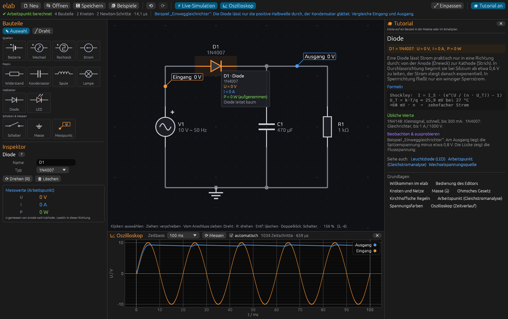

# elab – Elektronik-Lernlabor

Schaltungen bauen, simulieren und beim Arbeiten zusehen: ein Lernprogramm für
Elektronik in Rust, als Gegenstück zu [nnlab](https://github.com/markuseichinger/nnlab).



> **Stand: Phase 1** – Schaltplan-Editor mit Live-Simulation, Tutorial und Oszilloskop.

## Starten

```bash
cargo run --release                 # startet mit dem Beispiel „Spannungsteiler“
cargo run --release -- datei.elab   # öffnet eine gespeicherte Schaltung
cargo test --workspace              # alle Tests (Simulator, Netzliste, Modell)
```

## Was die App kann

- **Schaltplan-Editor** auf einem Raster: Bauteile platzieren, drehen, verschieben,
  löschen; Drähte vom Anschluss aus ziehen oder Ecke für Ecke verlegen.
  Angeschlossene Drähte gehen beim Verschieben mit und werden um Bauteile herum verlegt.
- **Live-Simulation:** Nach jeder Änderung wird der Arbeitspunkt neu berechnet.
  Drähte färben sich nach ihrer Spannung (grau 0 V, orange positiv, blau negativ),
  LEDs und Glühlampen leuchten entsprechend ihrem Strom bzw. ihrer Leistung.
- **Infofenster** beim Überfahren: Spannung, Strom, Leistung, Netzname, Leitzustand der Diode.
- **Inspektor:** Werte mit SI-Präfix eingeben (`4k7`, `100n`, `2,2 mA`, `1M`) und
  live sehen, wie U, I und P reagieren, inkl. Ohm-Probe und Warnungen (¼-W-Grenze, LED-Überstrom).
- **Oszilloskop:** Zeitverlauf an allen Messpunkten, Zeitbasis 100 µs … 1 s,
  automatische Neumessung nach jeder Änderung.
- **Tutorial-Leiste** wie in nnlab: Erklärung, Formeln, übliche Werte und Experimente
  zu jedem Bauteil und zu den Grundlagen (Knoten, Masse, Ohm, Kirchhoff, Arbeitspunkt …),
  mit Live-Werten des ausgewählten Bauteils.
- **Verständliche Fehler:** fehlende Masse, kurzgeschlossene Quellen, doppelte Namen,
  nicht verbundene Bauteile (werden markiert und übersprungen statt die Simulation abzubrechen).
- **Undo/Redo** für jede Änderung, **Speichern/Laden** als `.elab` (JSON),
  **sechs Beispielschaltungen**.

### Bauteile

Gleich-, Wechsel- und Rechteckspannung, Stromquelle, Widerstand, Kondensator, Spule,
Glühlampe, Diode (1N4148, 1N4007, Lehrbuch), LED (rot, gelb, grün, blau, weiß),
Schalter, Masse, Messpunkt. Schaltzeichen nach IEC 60617.

### Bedienung

| Aktion | Eingabe |
|---|---|
| Bauteil platzieren | in der Palette anklicken, dann in den Schaltplan klicken |
| Draht | vom Anschluss aus ziehen · oder `W`, Klick je Ecke, Doppelklick/`Esc` beendet, Leertaste wechselt den Knick |
| Drehen / Löschen | `R` / `Entf` oder `⌫` |
| Schalter umlegen | Doppelklick |
| Mehrfachauswahl | Rahmen ziehen, `⇧`-Klick, `⌘A` |
| Ansicht | Zwei-Finger-Wischen verschiebt, Pinch oder `⌘`+Mausrad zoomt, „⤢ Einpassen“ |
| Rückgängig / Wiederholen | `⌘Z` / `⇧⌘Z` |
| Neu / Öffnen / Speichern | `⌘N` / `⌘O` / `⌘S` |

## Aufbau

```
elab/
├── crates/elab-sim/      Simulationskern ohne UI (Phase 0)
│   ├── src/analysis.rs   MNA, Newton-Raphson, DC-Arbeitspunkt, Transientenanalyse
│   ├── src/circuit.rs    Schaltungsmodell und Fehlermeldungen
│   ├── src/diode.rs      Shockley-Modell mit pn-Spannungsbegrenzung
│   ├── src/waveform.rs   DC, Sinus, Puls/Rechteck, stückweise linear
│   └── tests/            Referenztests gegen analytische Lösungen
└── crates/elab-app/      Oberfläche (egui/eframe 0.37, wie nnlab)
    ├── src/model.rs      Schaltplan: Bauteile, Drähte, Raster, Undo
    ├── src/netlist.rs    Schaltplan → Netze → Simulator-Schaltung
    ├── src/sim.rs        Arbeitspunkt, Oszilloskop-Aufzeichnung, SI-Eingabe
    ├── src/examples.rs   Beispielschaltungen
    ├── src/editor.rs     Zeichenfläche, Werkzeuge, Live-Darstellung
    ├── src/symbols.rs    Schaltzeichen
    ├── src/tutorial.rs   Erklärtexte
    ├── src/script.rs     Testskripte für automatisierte Oberflächentests
    └── src/main.rs       Fenster, Panels, Inspektor, Oszilloskop, Dateien
```

## Oberflächentests

Die App lässt sich per Skript fernsteuern. Echte Maus- und Tastaturereignisse werden
eingespielt, Screenshots und der Dokumentzustand werden gespeichert:

```bash
cargo run --release -- --script crates/elab-app/ui-tests/schaltung_bauen.txt
```

Das Beispielskript baut eine LED-Schaltung von Grund auf, verdrahtet sie, verschiebt
und dreht Bauteile und prüft Undo. Befehle: siehe `src/script.rs`.

## Fahrplan

| Phase | Inhalt |
|---|---|
| **0** ✅ | Analogkern + Referenztests |
| **1** ✅ | Schaltplan-Editor, Live-Arbeitspunkt, Tutorial, Oszilloskop, Speichern/Laden |
| 2 | Digital-Engine (0/1/X/Z, ereignisgesteuert), Gatter, Flipflops, 74xx, Logikanalysator |
| 3 | Transistoren (BJT, MOSFET), Multimeter, Poti und Taster |
| 4 | Mixed-Signal-Brücke, OpAmp, 555, ADC/DAC, eigene ICs |
| 5 | Stromfluss-Animation, Echtzeit-Simulation, Kennlinien, Lektionen mit Aufgabenprüfung |
| 6 | Politur, macOS-Bundle |
